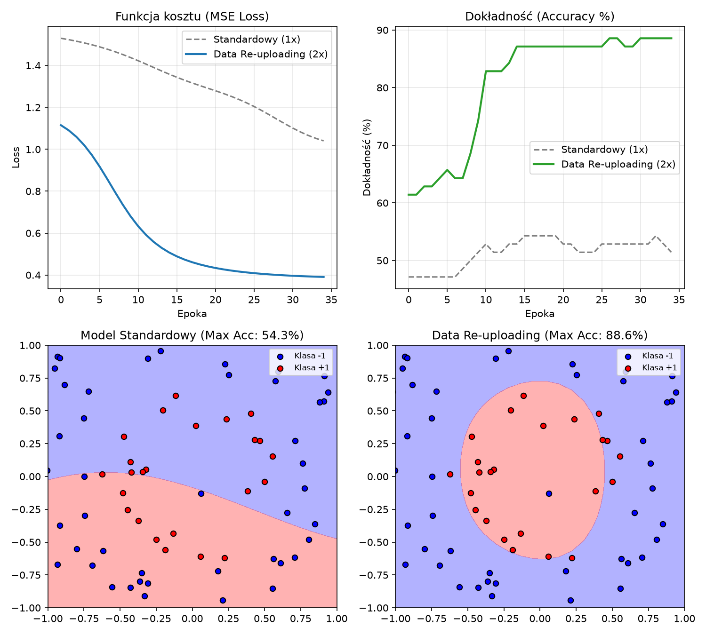

# Hipoteza (Wyzwanie 3)

## Obszar

Encoding

## Wstęp

Rozważamy problem zgadywania grupy dla pierścienia na przestrzeni 2x2 wyglądającej podobnie do:

```
_OO_
O__O
_OO_
```

_(będzie faktycznie bardziej zaokrąglony)_
gdzie `_` to klasa -1,
a `O` to klasa 1.

---

### Hipoteza:

# Użycie data reuploadingu pozwoli modelowi znacznie lepiej rozrózniać nieliniowe/zawiłe zasady grupowania/przewidywania

Zwykły model kwantowy używający tylko bramki Ry do kodowania danych sobie z tym nie poradzi - nie ma wystarczających zasobów matematycznych/sprawczości matematycznej aby wyrazić podzielenie przestrzeni 2D na 3 obszary, bo korzystać może tylko z sin(x) oraz cos(x).
Jeżeli damy modelowi możliwość (w postaci ponownego zakodowania danych, co po przekształceniach matematycznych pozwoli na większą ekspresywność w postaci sin(x), cos(x) ORAZ sin(2x), cos(2x) (itd w przypadku kolejnego zakodowania)), ten z niej skorzysta, bo pozwoli mu to obniżyć funkcję kosztu. Wynika to z potrzeby zmniejszenia okresu sinusoid, więc pomnożenia argumentu funkcji trygonometrycznych.

## Przewidywania

1. Dokładność modelu bez data reuploadingu będzie oscylował w okolicach 65% (m. in. z powodu większej ilości klasy -1) oraz możliwości dokonania tylko jednego podziału
2. Dokładność modelu z parokrotnym data reuploadingiem powinna skoczyć do około 90%, ponieważ rozdzielenie argumentów na 3 strefy jest możliwe ze względu na wyższą ekspresywność modelu. (90% m. in. ze względu na szum na granicach stref)

---

## Wyniki eksperymentu

Eksperyment przeprowadziłem na symulatorze z użyciem optymalizatora SGD (Parameter-Shift) na przestrzeni 2D dla 70 próbek przez 35 epok.



### Zestawienie wyników:

| Model                               | Parametry (wagi) | Max Accuracy | Końcowy Loss (MSE) |
| :---------------------------------- | :--------------: | :----------: | :----------------: |
| **Standardowy (1x Encoding)**       |        4         |  **54.3%**   |     **~1.01**      |
| **Data Re-uploading (2x Encoding)** |        6         |  **88.6%**   |     **~0.39**      |

---

## Weryfikacja przewidywań

**Przewidywania się w pełni sprawdziły:**

1. **Model bez Data Re-uploadingu osiągnął 54.3% dokładności** (przewidywałem ~65%), a jego MSE utknęło na poziomie ~1.01.
   - **Dlaczego:** Zgodnie z teorią pojedyncza warstwa bramek $R_y(x)$ ogranicza wyjście $\langle Z_0 \rangle$ wyłącznie do częstotliwości $\cos(x)$ i $\sin(x)$. Jak widać na mapie decyzyjnej, model zdołał poprowadzić tylko pojedyncze, gładkie cięcie na planszy - nie był w stanie wygiąć funkcji decyzyjnej tak, by zamknąć strefę pierścienia, przez co po prostu faworyzował liczniejszą klasę (-1), bo to zmniejszało jego błąd MSE.

2. **Model z Data Re-uploadingiem osiągnął 88.6% dokładności** (przewidywałem ~90%), a błąd MSE spadł do ~0.39.
   - **Dlaczego:** Ponowne wprowadzenie współrzędnych po warstwie wag i splątania CNOT odblokowało wyższe harmoniczne Fouriera ($\cos 2x, \sin 2x$). Pozwoliło to funkcji decyzyjnej na wykonanie podwójnego zwrotu wzdłuż promienia, zamykając czerwoną klasę wewnątrz zwartego obszaru i oddzielając ją od centrum oraz zewnętrznych krawędzi.

---

## Pytanie: "Co by się zmieniło, gdyby..."

**Pytanie:** _Co by się zmieniło, gdybyśmy w modelu z Data Re-uploadingiem usunęli bramki CNOT?_

**Odpowiedź:**
Tak naprawdę mielibyśmy do czynienia z dwoma niezależnymi modelami (jeden dla osi X, drugi dla Y - w naszym przypadku kompletnie nietrafny). Należy wziąć pod uwagę to, że w naszych pomiarach mierzymy tylko jeden kubit, więc jego wagi dostosowywałyby się do jak najmniejszego błędu, a wagi drugiego kubitu nie miałyby na błąd wpływu, więc mogłyby się zmieniać dowolnie. Model zredukowałby się do funkcji jednej zmiennej i mógłby tylko wyrażać proste, pionowe pasy, co, jak wiemy, w zadaniu klasyfikacji pierścienia byłoby kompletnie zgubne.
